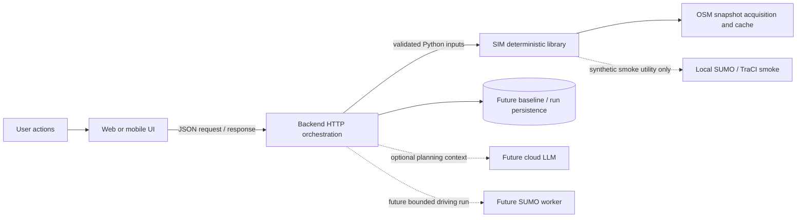

# Application integration handoff

**Status:** architecture alignment only. This document describes the current application and a future connection contract; it does not add an HTTP adapter or claim that frontend/backend/SIM integration exists.

**Remote application reviewed:** `origin/master` at [`bfdc43a8f58aa2c272b57673b2ee82bd89007f07`](https://github.com/AlexPintilie08/arteria/commit/bfdc43a8f58aa2c272b57673b2ee82bd89007f07), fetched 2026-10-17. A full fetch also found the separate `origin/feat/backend-api` branch at [`6f59b221bc0ff4f06b6256d5eeeea3097c0b19b4`](https://github.com/AlexPintilie08/arteria/commit/6f59b221bc0ff4f06b6256d5eeeea3097c0b19b4). The current working branch is `feat/sim-engine`; neither remote branch was changed or merged. Links in the source-reference list below remain pinned to `origin/master`.

## 1. Current application in one view

The repository contains a Next.js web frontend, a React Native mobile shell, a shared TypeScript package, and a Python standard-library HTTP server. The web workspace uses local fixtures by default. The backend handlers also return precomputed corridor data. No frontend or backend module imports the SIM package, and no current request passes a SIM result to either UI.

| Component | Implemented responsibility | Current integration state |
|---|---|---|
| Web and mobile | Area bookmarks, map/workspace presentation, analysis/scenario/comparison screens, shared TypeScript types and an HTTP client | Web defaults to an explicit demo preview. Its network client is used only when demo mode is disabled; scenarios and comparisons remain local fixture calculations. Mobile screens are placeholders and do not call the API client. |
| Backend | `GET /health`, `POST /analyze`, `POST /propose`, and `POST /evaluate` using Python's standard-library `HTTPServer` | Handlers use precomputed dictionaries in `backend/server.py`. They do not validate a SIM boundary, call SIM, persist snapshots, or invoke a cloud model. |
| SIM | Independent Python library for bounded OSM acquisition, graph analysis, neighborhood boundary validation, pedestrian-link screening, and graph-only route evaluation | Public Python APIs are available. There is no HTTP server, persistence layer, frontend dependency, LLM provider, SUMO job runner, or current backend adapter in SIM. |

The checked-in `backend/API_ENDPOINTS.md`, `docs/API_CONTRACT.md`, `api-specs/*.md`, and TypeScript interfaces are design contracts/examples. They do not make an endpoint or computation real. The [simulation-engine contract](https://github.com/AlexPintilie08/arteria/blob/bfdc43a8f58aa2c272b57673b2ee82bd89007f07/api-specs/simulation-engine-contract.md) proposes analytical and asynchronous SUMO routes, but those routes are not implemented by the current HTTP server.

### Separately inspected backend integration branch

`origin/feat/backend-api` adds 75 files or updates, including a bounded `/api/v1/spatial/studies` workflow, SQLite storage, a subprocess adapter/worker, typed frontend contracts and a dedicated spatial panel, setup scripts, and backend/frontend CI. Its `backend/prepare_sim.py` exports the locally available SIM commit `752c92da9184effc9b87704e0868320f569454ea` into an ignored snapshot; the branch does not import the current checkout's `sim/` tree. The workflow supports an offline fixture or bounded OSM acquisition, stores native analysis/candidate results, and compares only exact saved pedestrian-link candidates. Its response explicitly says `sumo_executed:false`; it does not consume the new proposal evidence/validation APIs or run SUMO. Branch documentation reports 60 passing tests, but that remote branch was inspected read-only and was not checked out or re-run here. The SIM v3 changes in this working branch leave `analyze_snapshot` and `evaluate_candidates` unchanged, but the backend integration has not been verified against this newer SIM revision.

## 2. Three-component responsibility boundary



The solid SIM path is an in-process Python library call. The backend owns HTTP validation and error mapping, authentication/authorization, stable analysis/baseline/scenario identifiers, persistence, LLM calls, and any future asynchronous worker lifecycle. SIM owns deterministic geospatial and numerical work and its source/assumption metadata. The UI owns user interaction, display, and cancellation; it must not turn fixture values into evidence.

The dotted SUMO worker and LLM paths are future responsibilities. The existing SUMO smoke utility is separate from SIM analysis and does not create real-area traffic results.

## 3. Actual user journey in the inspected frontend

The intended journey is **Select area → Analyze → Review issues → Choose scenario → Apply intervention → Evaluate → Compare Before/After**. In the inspected implementation, the web path is primarily a visual demonstration:

1. **Select area.** The web selector reads five bookmark records (`id`, `name`, `center`) from `frontend/shared/core/fixtures.ts`. MapLibre draws a second hardcoded fixture catalog of approximate polygons and corridors, while its basemap uses OSM raster tiles. These are not SIM neighborhood records and are not passed as analysis boundaries. The UI labels them as orientative/estimated.
2. **Analyze.** `NEXT_PUBLIC_DEMO_MODE` defaults to demo mode unless set to the literal string `false`. Demo mode calls `createDemoAnalysis`, which returns null/unknown indicators, no issues, and a preview warning without making an API request. In API mode, `Workspace.tsx` sends `city_id`, `area_id: preview-<bookmark>`, `boundary: null`, `boundary_source: known_area`, and `crs`, plus requested layers, `walk`/`bike`, a 15-minute walking threshold, and `data_as_of: null`. The client uses a 30-second abort timeout. This is not a validated SIM area request.
3. **Review issues.** The indicator cards use `result.indicators`, but the issue cards and map pins use `demoIssuesByNeighborhood` from the local fixture module, not `result.issues`. The web analysis panel also displays hardcoded corridor telemetry for some bookmark IDs. The backend's issue response therefore does not currently drive selection or map geometry.
4. **Choose a scenario.** `ScenarioPanel` selects hardcoded proposals from `allDemoIssues`. Proposal text, intervention strings, qualitative impact labels, timeframe, cost category, and “validated” presentation are fixture content. Sliders update React state and local equations; they do not call `/propose`, `/evaluate`, SIM, or SUMO.
5. **Apply and evaluate.** “Apply” stores tuning values, flips `hasAppliedScenario`, and navigates to comparison. It does not submit structured interventions or an evaluation request. Quick-apply from the comparison page changes the same local state.
6. **Compare and export.** `ComparisonPanel` reads `comparisonData` from the selected fixture issue and applies local traffic-regime/load multipliers plus local tuning adjustments. Its report and JSON download are generated in the browser. No baseline/scenario ID, backend evaluation ID, SIM result, or SUMO run is created. The visible source/method claims are not established by these formulas.

The mobile app shares fixtures and types, but its Explore map is a `MapPlaceholder`; its analysis uses `emptyIndicators()`, and its scenario/comparison screens show pending-integration notices. `frontend/mobile/src/lib/api.ts` defines the shared client but these screens do not invoke it.

## 4. Implemented backend routes and their actual behavior

The inspected [`backend/server.py`](https://github.com/AlexPintilie08/arteria/blob/bfdc43a8f58aa2c272b57673b2ee82bd89007f07/backend/server.py) is authoritative for the current runtime:

| Implemented route | Current behavior | Consequence for integration |
|---|---|---|
| `GET /health` | Returns a small liveness payload. | It does not prove SIM, OSM, LLM, or SUMO readiness. |
| `POST /analyze` | Reads `area.area_id`, removes the `preview-` prefix, selects a precomputed dataset, and falls back to `podu-ros` for an unknown identifier. It echoes the submitted area and returns static indicators/issues, fixed layer statuses/dates, and empty warnings. | It ignores boundary geometry, requested layers/modes/thresholds, and `data_as_of`; it neither validates the area nor returns SIM GeoJSON/network layers. Unsupported IDs can silently display Podu Roș results. |
| `POST /propose` | Reads/echoes `problem_id` with a default, then always returns `DATASETS["podu-ros"]["proposals"]`, a fixed catalog version, and rule-catalog metadata. | It does not resolve the analysis or issue, honor requested alternatives/constraints, produce structured geographic interventions, or call an LLM. |
| `POST /evaluate` | Reads `alternative`, selects a precomputed comparison column from `DATASETS["podu-ros"]`, subtracts baseline from scenario, and returns metrics plus a notice. Any unrecognized alternative selects the transformative column. | It ignores area, baseline, proposal, intervention, indicator, and simulation fields. The subtraction is over stored numbers; it is not a SIM route evaluation or SUMO run. |

The handlers have no neighborhood lookup, scenario persistence, job status, SSE stream, runtime schema validation, or SIM import. Their error payloads are not consistent with the richer documented `ApiErrorBody` contract. The `honest_notice` text is a string emitted by the handler; it is not evidence that the stored metrics were recomputed from an OSM graph.

## 5. Current SIM entry points and result boundaries

The public exports are in [`sim/__init__.py`](__init__.py); detailed schemas remain in [ARCHITECTURE.md](ARCHITECTURE.md) and usage examples in [README.md](README.md). The following functions and parameters were verified against the current `feat/sim-engine` source:

| Purpose | Public API | Actual result / constraint |
|---|---|---|
| Validate an area | `normalize_area(area, *, max_area_km2=5.0, max_extent_km=5.0)` | Returns `StudyArea` with Polygon/MultiPolygon, IDs, boundary source, extent, and a local metric working CRS; rejects invalid or oversized geometry. |
| Acquire OSM | `acquire_osm_data(area, *, modes=("walk", "bike", "drive"), cache_dir=None, use_cache=True, force_refresh=False, overpass_url=None, max_area_km2=5.0, max_extent_km=5.0)` | Returns `OSMData`: successful mode graphs, feature layers, per-layer/mode availability, source metadata and warnings. Network acquisition is bounded and may make external OSM/Overpass requests; the UI must call it through backend policy, not directly. |
| Analyze a snapshot | `analyze_snapshot(data, *, access_threshold_minutes=15.0, walking_speed_mps=1.3, cycling_speed_mps=4.5, poi_snap_tolerance_m=150.0, detour_ratio_threshold=2.0)` | Returns JSON-ready indicators, deterministic issues, issue GeoJSON, heatmaps, layer/network GeoJSON, per-mode metrics, availability, provenance, uncertainty, and warnings. Values describe mapped graph/features, not residents or observed traffic. |
| Convenience acquisition + analysis | `analyze_area(area, **options)` | Acquires then analyzes. Use `acquire_osm_data` + `analyze_snapshot` when a backend needs to preserve and reuse one baseline snapshot. |
| Catalog selection | `load_neighborhood_catalog`, `get_neighborhoods`, `get_neighborhood`, `search_neighborhoods`, `neighborhoods_geojson` | Reads the tracked partial Iași OSM place catalog. A record exposes `id`, `name`, GeoJSON `geometry`, geometry type, source/object ID, boundary/review status, provenance, retrieval time, and uncertainty notes. There is no HTTP route for it yet. |
| Boundary validation | `validate_neighborhood_boundary(neighborhood, catalog=None, *, max_area_km2=5.0, max_extent_km=5.0)`; `neighborhood_area_input(...)` | Distinguishes point-only records from Polygon/MultiPolygon boundaries, validates without altering source geometry, and returns an acquisition input only for an eligible polygon. |
| Candidate discovery | `discover_intervention_candidates(data, *, issues=(), max_candidates=3, candidate_pool_limit=100, ...)` | Bounded search over the walking graph; emits only hypothetical `add_pedestrian_connection` actions and screening evidence. Candidate results can be rejected or conditional; they are not buildability recommendations. |
| Single-route graph edit | `evaluate_scenario(data, interventions, *, origin, destination, max_snap_distance_m=50.0, walking_speed_mps=1.3)`; `evaluate_pedestrian_connection(...)` | Applies supported pedestrian graph edits to an isolated graph and returns before/after route status, distances, assumed time, comparison, provenance, and warnings. Baseline graph is not mutated. |
| Route sampling and impact | `sample_route_pairs(...)`, `evaluate_multi_route_impact(data, interventions, *, route_pairs=None, sample_count=32, seed="arteria-v1", ...)`, `evaluate_candidates(...)` | Accepts explicit directed graph-node pairs or a deterministic hash-selected sample. Impact includes route rows and aggregates. Candidate ranking uses one shared sample; separate endpoint-local diagnostics are not representative and do not affect ranking. |

`RouteError` is exported from `sim.analysis`, not from the package root. Public/package exceptions include `AreaValidationError`, `OSMDataError`, `InterventionError`, and `NeighborhoodCatalogError`. The signatures above are a concise integration reference, not a replacement for each function's source-level validation.

## 6. Neighborhood selection and geographic contract

The current frontend bookmark ID is a UI key, not a stable SIM/backend area ID. The current backend's prefix removal and fallback must not be used to resolve geography in a real integration.

Recommended selection flow:

1. Backend supplies a catalog version and normalized neighborhood records from `get_neighborhoods()` or `neighborhoods_geojson()`. Keep the source ID as `area_id`; keep the UI bookmark ID separately if the UI needs one.
2. A selectable analysis area must have a source-mapped Polygon or MultiPolygon. A point-only named place remains a map/search result and must return `point_only`; do not buffer it or invent a boundary.
3. Preserve the record's source object ID, OSM source, provenance, retrieval date, review status, and uncertainty notes. Label the geometry as an OSM place extent, not an official municipal/legal neighborhood boundary.
4. Call `validate_neighborhood_boundary` and then `neighborhood_area_input`. The standard area policy is at most 5 km² and at most 5 km in either extent dimension. Larger analyses require an explicit controlled-analysis policy. SIM does not alter/simplify the selected boundary.
5. Pass the validated area object through the backend adapter to `acquire_osm_data`/`analyze_area`. `StudyArea` works in a locally selected metric CRS; exported GeoJSON returns to EPSG:4326.

Coordinate convention is a contract: GeoJSON positions are `[longitude, latitude]`; bbox input is `[west, south, east, north]`. The shared frontend `Geometry` union currently has Point, LineString, and Polygon only, while SIM accepts MultiPolygon areas and neighborhood records. Update/validate the shared wire schema before sending those geometries. Do not reverse coordinates or silently coerce MultiPolygon to Polygon.

**Illustrative SIM area input** (example bbox only; not a catalog boundary or current API request):

```json
{
  "city_id": "iasi-ro",
  "area_id": "example-bounded-study-area",
  "bbox": [27.5755, 47.161, 27.5825, 47.1655],
  "crs": "EPSG:4326",
  "boundary_source": "user_selected"
}
```

Frontend `boundary_source: "known_area"` and `boundary: null` do not satisfy this validated-area contract. Treat them as view state until a real catalog ID and boundary have been resolved.

## 7. Analysis request, indicators, issues, and map layers

### Analysis mapping

The web's draft `AnalyzeRequest` contains `area`, layer IDs, `analysis.network_modes`, per-mode accessibility thresholds, and `data_as_of`. SIM supports network modes `walk`, `bike`, and `drive`; `analyze_area`/`acquire_osm_data` accept modes, while `analyze_snapshot` currently accepts one shared `access_threshold_minutes` for walking and cycling. A list with different walk and bike thresholds cannot be represented by that single parameter without a deliberate adapter strategy or a SIM API change.

The SIM acquisition layer keys are `roads`, `walking_infrastructure`, `cycling_infrastructure`, `crossings`, `buildings`, `schools`, `healthcare`, `services`, `public_transport`, `parking`, and `green_space`. Frontend IDs such as `walking`, `cycling`, and `points_of_interest` need a documented mapping; `points_of_interest` expands to categories and is not one SIM layer. SIM does not currently accept a requested layer subset; the backend can filter presentation after acquisition, but must not imply that omitted source layers were not queried.

Real SIM analysis may return network counts/components, node-based access/detour indicators, and issue types such as disconnected components, poor mapped-service access, or detour screening. Its issue fields include stable area/type-based ID, type, severity, description, WGS84 geometry, metrics/units, OSM evidence, data coverage, method provenance, and uncertainty. `issue_geojson`, `layers`, `networks`, and `heatmaps` are map-ready GeoJSON outputs. Empty layers and unavailable networks stay unknown/explicitly unavailable; they are not proof of real-world absence.

The active web map currently ignores those outputs and draws fixture polygons, corridors, and issue pins. Its client must render returned SIM GeoJSON and associate selected issues by stable issue ID after integration. OSM raster basemap tiles are a visualization source, not evidence that the analysis ran on those tiles.

### Errors, partial data, and timeouts

`normalize_area` raises `AreaValidationError` for invalid or over-limit geometry. `acquire_osm_data` preserves per-mode partial failures as availability/warnings when another requested graph succeeds and raises `OSMDataError` when every requested graph fails; feature-query failure leaves affected layers unknown with warnings. Candidate discovery can return an explicit empty report reason, while invalid scenario inputs raise intervention/value errors. A future backend adapter should map these to stable client errors (for example invalid input to 422, total source unavailability to 503, and partial success to a successful response with warnings) without flattening `unknown` into zero.

The shared client aborts a request after 30 seconds by default. OSM acquisition can exceed that budget, and the current synchronous standard-library server has no cancellation or job-status protocol. The backend owner must set an explicit request/deadline policy or separately design an accepted-job workflow for long work; an aborted browser request must not be reported as proof that backend/SIM work was canceled.

### Issue and proposal representation

The shared TS `Issue` is explicitly marked provisional. It expects `id`, `label`, `indicator_ids`, `geometry`, and `Evidence` fields; backend issue objects use `title`, `category`, `location_name`, `coordinates`, `description`, `supporting_indicator_id`, and `severity`; SIM issues use `type`, `description`, metrics/evidence/coverage/provenance and GeoJSON geometry. Translate field names only when the underlying evidence exists. Backend fixture issues do not gain SIM provenance or geometry by renaming `coordinates`.

Keep five proposal categories distinct:

1. **AI planning concept:** a language model may explain evidence and suggest a structured option with assumptions. Text is not an evaluated intervention.
2. **Deterministic SIM candidate:** a bounded graph search result, with candidate ID and screening reasons. It is not an AI proposal or construction recommendation.
3. **Supported graph intervention:** an explicit graph edit that SIM validates and evaluates, currently limited to modeled pedestrian connections and toggling such a connection.
4. **SUMO-dependent traffic intervention:** signal timing, transit priority, demand changes, lane/vehicle-flow changes, or roadway capacity changes require a real conversion/demand/simulation capability that is not present.
5. **Unsupported physical concept:** grade-separated underpasses, tunnels, new bridges, turbo-roundabouts, or any construction concept requiring physical/geotechnical/legal checks cannot be represented as validated by the current pedestrian graph API.

The actual scenario edit shape is small and strict. **Illustrative only; coordinates must be in-area and within SIM's snapping/length limits:**

```json
{
  "type": "add_pedestrian_connection",
  "start": [27.58, 47.162],
  "end": [27.581, 47.163]
}
```

SIM checks coordinate validity, in-area placement, walking-node snapping, and connection length (maximum 1,000 m). It screens mapped buildings during candidate discovery, but mapped coverage is incomplete; water/barriers, slope, ownership, access rights, safety, legal approval, accessibility compliance, and construction feasibility remain unknown. `set_connection_enabled` only toggles a modeled ARTERIA virtual pedestrian connection; it does not change real road operations.

### Intervention capability catalog

| Capability/type | Current SIM status | Evidence/result boundary |
|---|---|---|
| `add_pedestrian_connection` | Supported graph edit | Hypothetical walk-graph edge; route distance/reachability changes can be calculated. Never label it physically buildable. |
| `set_connection_enabled` | Supported for a modeled ARTERIA pedestrian connection | Adds/removes that modeled graph edge in the scenario copy. It cannot target an arbitrary real road or control device. |
| Disconnected-component / directed reachability / detour candidate search | Supported bounded discovery | Candidate screening is deterministic and conditional; returns screening evidence and candidate geometry, not a recommendation. |
| Walking/cycling/driving baseline network analysis | Supported, subject to returned source coverage | OSM graph metrics and selected access indicators; no real trip counts, population inference, congestion, delay, or traffic flow. |
| Signal retiming, CTP priority, lane width, traffic demand, turbo-roundabout, underpass/tunnel/bridge | Unsupported by current SIM evaluation | The UI/backend fixtures or specifications do not confer a capability. Requires a future validated model and, where traffic behavior is claimed, calibrated SUMO or another justified model. |
| Cost, buildability, ownership, approval, safety, accessibility compliance | Unsupported | Requires external data/review; graph topology cannot establish these facts. |

### SIM v3 proposal preparation and validation

The SIM package now exports get_intervention_catalog, build_proposal_context, prepare_candidate_options, validate_proposal, and validate_proposal_set. The catalog version is arteria-sim-interventions-v1. A proposal context is a bounded, deterministic evidence packet with study-area geometry hash, source metadata, analysis issues/metrics/uncertainty, ranked candidate geometry and obstacle screening, shared and targeted Before/After route samples, ranking methodology, and explicit capability limitations. It does not contain a full graph or call a cloud model.

Candidate options come only from evaluate_candidates results and only the current add_pedestrian_connection action is generated. The option has a stable candidate ID, SIM endpoint action (start/end in EPSG:4326), candidate GeoJSON geometry, real graph-sample aggregate, source/screening caveats, and unknown physical feasibility. SIM does not force minimal/moderate/transformative categories or infer costs from link length.

validate_proposal treats proposed JSON as untrusted. It requires a candidate from the supplied evaluated set, exact intervention/action match, finite in-area coordinates, and supported units; it rejects unsupported types, unknown candidates, fabricated citations/run IDs, unsupported observed metrics, cost claims, physical-feasibility claims, and untrusted validated/accepted status fields. It reports schema_status, support_status, evaluation_status, and physical_feasibility separately. Even a candidate-backed evaluated graph scenario says nothing about physical buildability.

The latest inspected origin/master TypeScript draft (frontend/shared/core/contracts.ts, at bfdc43a8f58aa2c272b57673b2ee82bd89007f07) is not wire-compatible with the SIM option. Its Alternative requires a level, prose summary/rationale, interventions with geometry and parameters, provider/model timestamps, expected impacts, assumptions, and a validation block. SIM instead returns a candidate ID, start/end action, graph evaluation/sample, and no LLM metadata or planning class. The frontend Intervention requires geometry and has no supported discriminated shape for set_connection_enabled; its Geometry union also omits MultiPolygon for areas. The backend must define a versioned adapter/union and must not claim SIM generated provider metadata, frontend planning levels, traffic metrics, cost, or physical feasibility. Its existing hardcoded /propose response and illustrative traffic improvements remain non-SIM fixture data.

The `origin/master` contract/spec changes from the SIM branch's common base are draft TypeScript/API and SUMO/Webster/HCM examples; no matching proposal endpoint or evaluator exists there. The separately inspected `origin/feat/backend-api` branch supplies a distinct graph-study API, but pins the older SIM commit above and does not consume the SIM v3 proposal packet or execute SUMO. Its API does not make the TypeScript signal-timing Alternative compatible with SIM options. These integrations remain separate until an explicit branch integration and versioned adapter are completed.

## 8. Graph evaluation and immutable baseline contract

The backend should store or retain the exact `OSMData` baseline snapshot and its source metadata under a stable backend `baseline_id`. A request's `baseline_id` must resolve to that same validated area, OSM snapshot, and analysis—not trigger an unnoticed reacquisition. SIM's `evaluate_scenario`, `evaluate_multi_route_impact`, and `evaluate_candidates` evaluate graph edits on copies; alternatives do not accumulate edits into the baseline.

For a candidate set, `evaluate_candidates` screens a bounded opportunity pool, evaluates eligible candidates against one deterministic shared graph-node sample, and ranks only from that common sample. It can also include candidate-specific nearby route diagnostics; these are explicitly nonrepresentative and excluded from ranking. For direct evaluation, `sample_route_pairs` can receive explicit directed graph-node IDs or select seeded pairs. The caller must preserve the seed, requested/evaluated sample count, and configuration in the evaluation record.

SIM's actual computed outputs include route status, network/direct distances, detour ratio, constant-speed walking-time estimate, route geometry when within its geometry cap, outcome categories, and aggregate counts/savings among pairs reachable both before and after. The sample is a graph diagnostic, not observed demand or a statistical population sample. A `newly_reachable` pair has no comparable before-distance; do not invent a distance/time saving for it. Improvement percentage remains null in SIM.

Graph evaluation and SUMO traffic simulation are separate engines. Graph access/connectivity results cannot be relabeled as `veh/h`, queue length, signal delay, emissions, traffic LOS, tram speed, or crash/safety effects.

## 9. Before/After response contract

The frontend's draft `EvaluateResponse` has `comparisons[]` with baseline/scenario/delta `Measurement` objects and a separate simulation object. The backend's current response instead has `metrics[]` with numeric baseline/scenario/delta, method text, an `alternative` string, and `honest_notice`. SIM has its own graph-route and candidate schemas. These are not interchangeable.

For a future adapter, each comparison row should carry:

- stable `indicator_id`, human-readable `label`, and canonical `unit`;
- `baseline`, `scenario`, and `delta` with `value: number | null`, unit, epistemic status (`observed`, `calculated`, `estimated`, `unknown`), source provenance, and uncertainty;
- assumptions and method, with the same area/source snapshot and compatible calculation settings for both sides;
- an explicit evaluation engine/mode (`graph`, `sumo_live`, `sumo_replay`, or `none`) where relevant, plus baseline/scenario/evaluation/run IDs;
- null values when an input, measurement, or comparable result is unavailable. Do not substitute zero or a guessed percentage.

**Illustrative schema only; these example values are not produced by a current endpoint or claimed as Iași observations.** A real adapter may derive sampled reachable-pair counts from SIM's route rows; a traffic delay remains unknown until measured or computed by a supported traffic model:

```json
{
  "indicator_id": "walk_sample_reachable_pairs",
  "label": "Reachable pairs in the shared graph-node sample",
  "unit": "pair",
  "baseline": {"value": 17, "unit": "pair", "status": "calculated", "provenance": [{"source": "OpenStreetMap snapshot", "source_version": "<persisted snapshot version>", "retrieved_at": "<snapshot timestamp>", "method": "NetworkX weighted shortest paths", "crs": "<working CRS>"}], "uncertainty": {"kind": "sample", "description": "Illustrative 32-pair graph sample; not observed trips.", "interval": null, "confidence": null}},
  "scenario": {"value": 18, "unit": "pair", "status": "calculated", "provenance": [{"source": "OpenStreetMap snapshot", "source_version": "<persisted snapshot version>", "retrieved_at": "<snapshot timestamp>", "method": "NetworkX weighted shortest paths", "crs": "<working CRS>"}], "uncertainty": {"kind": "sample", "description": "Illustrative 32-pair graph sample; not observed trips.", "interval": null, "confidence": null}},
  "delta": {"value": 1, "unit": "pair", "status": "calculated", "provenance": [{"source": "Same OSM snapshot and route-pair sample", "source_version": "<persisted snapshot version>", "retrieved_at": "<snapshot timestamp>", "method": "Scenario count minus baseline count", "crs": "<working CRS>"}], "uncertainty": {"kind": "sample", "description": "Scenario minus baseline for the same sample.", "interval": null, "confidence": null}},
  "assumptions": ["Same immutable OSM graph snapshot and same route-pair sample."],
  "evaluation_mode": "graph"
}
```

An adapter must not label a constant-speed walk-time estimate as observed. It must keep unit conversion explicit, use null when baseline/scenario populations are not comparable, and preserve SIM's source/method/warning fields. The existing TS `Provenance.retrieved_at` is non-nullable while SIM can have absent timestamps in synthetic/offline data; the wire contract needs nullability or an explicit unknown state.

## 10. SUMO workflow: intended contract versus implemented support

SIM v3 adds `sumo_engine.py`: it consumes an existing directed driving graph, transforms coordinates to the selected metric CRS, writes bounded SUMO plain-XML inputs and a source-ID map, and generates deterministic synthetic OD routes without network access. It exports network GeoJSON in EPSG:4326. `run_real_area_simulation` calls local `netconvert` and `sumo` only when available, applies graph/vehicle/duration/wall-clock limits, and parses tripinfo only after a successful process exit. Completed/incomplete trip counts, waiting time, route length, and movement checks are derived from actual simulator output; route GeoJSON is emitted only for completed vehicles.

Local verification prepared a 40-node/78-directed-edge cached Iași drive graph and 20 seeded synthetic routes. `netconvert` and `sumo` are absent on this machine, so no SUMO network was built and no vehicle moved in a simulator. The legacy cached graph lacks a matching source-geometry hash, so its area equivalence is unverified. The module returns unavailable at `network_conversion` without fabricated traffic metrics. The existing `sumo_support.py` one-step synthetic TraCI smoke remains separate and is not evidence of real-area execution.

The remote `api-specs/simulation-engine-contract.md` proposes `POST /api/v1/simulation/sumo/run`, an SSE stream, and an analytical-evaluation endpoint. None is registered in `backend/server.py`; do not wire the frontend to these paths as if they existed.

For a later backend-owned SUMO service, the realistic lifecycle is:

1. Resolve a validated geographic area and acquire a driving network with OSM source/time/version metadata.
2. Convert that exact source snapshot with an explicit converter version/configuration; report unsupported/missing lane, turn, signal, tram, and restriction details rather than silently inventing them.
3. Generate or load synthetic demand with documented origin/destination, time regime, vehicle mix, seed, calibration status, and explicit synthetic label.
4. Enforce queue limits, duration/warm-up caps, resource limits, cancellation, and run identity before starting a worker. Store job/run state in the backend; SIM's current API is synchronous and has no job lifecycle.
5. Return a run ID and status. On completion, store simulator/version, source network snapshot, configuration, seed, demand provenance, warnings, and actual measured/modelled metrics. Failed or timed-out runs return explicit failure status, not an empty success.
6. Return map layers only when the simulator actually produced them and label their CRS/source. Replay must reference the immutable original run, exact configuration, and result artifacts; it must not masquerade as a fresh live run.
7. Compare baseline and scenario only with matched network, demand, time horizon, warm-up, and seed policy. Report variance/uncertainty for repeated stochastic runs; a single run is not a measured field observation.

Until these capabilities exist, `traffic_simulation.requested` should be false or return unavailable; frontend simulation controls and API specs are not evidence of a completed run. The proposed endpoint/payload above is documentation only, not a final stable contract.

## 11. Provenance, epistemic status, and AI boundary

SIM must remain deterministic and independent of LLM providers. For AI planning, the backend can provide SIM's validated area, analysis ID, indicators, issue evidence/geometry, layer availability, source snapshot, candidate screening, route sample configuration, evaluation output, assumptions, warnings, and uncertainty. Preserve the source mapping from each suggestion back to those facts.

An LLM may explain supported issues, produce structured concept alternatives, state assumptions, and compare evaluated supported options. It may not invent traffic observations, source geometry, candidate screening, SUMO outputs, confidence intervals, physical feasibility, public approval, or validation. A concept requiring unsupported capability must be marked not evaluated and cannot be sent as a validated SIM intervention.

Use epistemic status consistently:

- `observed`: sourced sensor/field data with real source, time window, method, units, and provenance. The reviewed backend's detector claims are hardcoded sample payloads, not independently verified measurements.
- `calculated`: deterministic output from a named source snapshot and method, such as graph node counts, shortest-path lengths, or graph-pair outcome counts.
- `estimated`: a model/assumption-based quantity such as constant-speed walking time; describe the assumption and uncertainty.
- `unknown`: unavailable, failed, unverified, or unsupported. Preserve null values and the reason.

SIM OSM metadata includes mode/layer availability, retrieval data, tags, area IDs/boundary source, working CRS, warnings, and—on new cache sidecars—the normalized source polygon and SHA-256. Historical cache entries without matching source geometry may leave area equivalence unverified. Keep the ODbL attribution/license information. OSM incompleteness, absent mapped features, and lack of a feature query do not establish real-world absence.

## 12. Contract compatibility matrix

This matrix compares the current frontend/shared contract, actual backend handler, and actual SIM API. “Expected response” means the shared frontend types or displayed web state, not proof of a live integration.

| Operation / frontend request and expected response | Backend request and actual response | SIM function / actual output | Adapter, missing capability, or data-quality concern |
|---|---|---|---|
| **Select area:** `Area {city_id, area_id, boundary, boundary_source, crs}`; frontend currently uses `preview-*` and `boundary: null`. Expected analysis response echoes an `AreaRef`. | `/analyze` strips the prefix and falls back to Podu Roș; echoes the supplied area. No catalog lookup or boundary validation. | `get_neighborhood*`, `validate_neighborhood_boundary`, `neighborhood_area_input`, `normalize_area`; sourced Polygon/MultiPolygon, point-only status, area caps, provenance. | Use catalog IDs and validated geometry; preserve UI key separately. Silent backend fallback is a data-quality bug. Frontend geometry currently excludes MultiPolygon. **Category:** missing backend feature + schema adaptation + source-boundary limitation. |
| **Analyze modes/layers:** `layers[]`, `analysis.network_modes[]`, per-mode `accessibility_thresholds[]`, `data_as_of`. Expected typed indicators/issues/layer status. | Handler ignores all these inputs and returns dataset fields with fixed layer list/dates. | `acquire_osm_data(... modes=...)`, `analyze_snapshot(... access_threshold_minutes=...)`; mode metrics and accessible categories from returned OSM coverage. | Map shared layer IDs to SIM categories; decide layer filtering and per-mode threshold policy. Backend needs acquisition/analysis orchestration and error/status translation. **Category:** naming adaptation + missing backend feature + per-mode threshold capability gap. |
| **Indicators/evidence:** `Indicator` has `id`, `label`, `value|null`, `unit`, status, provenance, uncertainty. | Static values carry backend-specific status and provenance; some source names/dates/methods are embedded in fixture dictionaries. | Calculated/estimated indicator dictionaries with method/source provenance and uncertainty; unavailable source values remain null. | Do not copy fixture status into evidence. Use a backend source record for actual observations, otherwise `unknown`; map units and status explicitly. **Category:** serialization adaptation + source-data verification. |
| **Issues:** draft `Issue {id,label,indicator_ids,geometry,...Evidence}`; web actually uses `DemoStudyIssue` fixtures. | Static issues use `title`, `category`, `location_name`, `coordinates`, `supporting_indicator_id`, `severity`; not the provisional TS shape. | Deterministic issue `id/type/severity/description/geometry/metrics/evidence/data_coverage/provenance/uncertainty`. | Make selected IDs refer to one persisted analysis. Derive a GeoJSON geometry only from a real point/feature result; do not rename fixture coordinates into sourced geometry. **Category:** naming/serialization adaptation + missing issue persistence + evidence-quality gap. |
| **Propose request:** `analysis_id`, `area`, `issue_id`, `intervention_catalog_version`, constraints, `requested_alternatives[]`. Expected `proposal_set_id`, model metadata and structured alternatives. | Reads `problem_id`; returns `proposal_run_id`, `problem_id`, `catalog_version`, `model_metadata`, fixed alternatives, `validation`. It ignores request context. | SIM has deterministic candidate discovery, not an LLM proposal endpoint. Candidate object contains a supported graph edit and screening evidence. | Change backend to resolve analysis/issue, and keep generated concepts separate from screened SIM candidates. No mapping from prose interventions to geometry exists. **Category:** `issue_id`/`problem_id` naming + missing backend feature + unsupported proposals. |
| **Alternative level:** frontend union is `minimal | moderate | transformative`. | `/evaluate` reads `alternative`; unknown strings become transformative. `/propose` returns all three fixed levels. | SIM evaluates explicit interventions; it has no minimal/moderate/transformative scale. | Treat the level as a planning label that selects structured intervention sets, not as a SIM parameter. Validate against enum; reject unknown values. **Category:** `alternative`/`alternative_level` naming + semantics missing. |
| **Intervention shape:** shared `Intervention {type, geometry, parameters,...}`. | Proposal payload uses display strings in `interventions[]` and qualitative `impacts[]`; evaluator ignores any submitted action. | `evaluate_scenario` accepts `add_pedestrian_connection` with `start`/`end` lon-lat or `set_connection_enabled` for a modeled connection ID. | Build a narrow schema adapter only for supported types; keep structured geometry/units and validate before calling SIM. A text concept is not executable. **Category:** serialization adaptation for graph-link types; other types are unsupported. |
| **Evaluate request:** `baseline_id`, `proposal_set_id`, `alternative_level`, `interventions`, indicator selection, simulation request. Expected evaluation/scenario IDs, comparisons and simulation metadata. | Reads only `alternative`, ignores the rest. Response uses `evaluated_at`, `alternative`, `metrics[]`, and a notice. | `evaluate_multi_route_impact`/`evaluate_candidates` accept an `OSMData` snapshot and graph edits; output sample, route rows, aggregates, configuration, provenance, assumptions, warnings. | Backend must resolve immutable snapshots, run supported graph evaluation, persist IDs, and assemble the response. **Category:** missing backend evaluation/persistence; not a field-only adapter. |
| **Before/After rows:** frontend expects indicator IDs and evidence-aware `Measurement` baseline/scenario/delta. | Static `metrics[]` rows contain label/unit/raw numbers/method. | Route/aggregate outputs with graph pair counts, route distances, time assumptions and null savings when incomparable. | Normalize only supported SIM outputs; preserve unit/status/provenance/uncertainty and attach sample assumptions. Traffic metrics stay null/unknown. **Category:** response serialization + missing measurement capability for traffic. |
| **GeoJSON map layers:** frontend expects `Geometry`, currently lacks MultiPolygon and does not wire response layers into MapViewport. | `/analyze` has no SIM `layers`, `networks`, `issue_geojson`, or `heatmaps`. | SIM outputs FeatureCollections in WGS84 for issue/layer/network/heatmap data. | Extend/validate TS geometry and connect returned layers to MapLibre. **Category:** missing backend pass-through + frontend integration/schema support. |
| **SUMO/live/offline/replay:** TS has `SimulationRequest` with `none/live/offline/replay`; app shows seed/config controls as demo state. | No SUMO routes/jobs in current server. | Only executable discovery and synthetic smoke; no real-network conversion, demand, job, result, or replay APIs. | Do not map a UI seed or API-spec job example to a run. Build the backend lifecycle and real SIM/SUMO capability separately. **Category:** missing SIM capability + missing backend job system. |
| **Errors/timeouts:** client `ApiErrorBody` expects code/message/details/request_id; web transport aborts at 30 seconds. | Current invalid JSON error is partial; unknown path is 404; validation and SIM errors are not consistently mapped. | `AreaValidationError`, `OSMDataError`, `InterventionError`, `NeighborhoodCatalogError`, and route errors are Python exceptions. | Backend must validate requests and map domain exceptions to stable HTTP codes, structured details, request IDs, and explicit timeout/partial-data states. **Category:** missing backend behavior. |

## 13. Known integration blockers

1. Web demo data drives issue selection, scenarios, and comparisons independently of `AnalyzeResponse`; default mode makes no API request.
2. Backend handlers return precomputed datasets, fallback on unknown area IDs, and do not import or call SIM.
3. Frontend area bookmarks have no source polygons; the shared geometry union omits MultiPolygon; SIM neighborhood catalog has OSM place extents, not official boundaries.
4. Frontend analysis request can ask for per-mode thresholds, while SIM's current analysis parameter is shared for walk/bike.
5. TS, backend, and SIM issue/proposal/evaluation schemas differ. Backend proposals are prose strings, not structured SIM actions.
6. Backend scenario/evaluation IDs and persistence are absent. The evaluator does not consume interventions or a baseline snapshot.
7. Current frontend comparative numbers and detector/source claims are fixture data/local arithmetic. They must not be presented as verified measurements.
8. Traffic-signal, transit, roadway-capacity, demand, emissions, queue, and SUMO replay capabilities are not implemented in SIM.
9. Source-coverage/uncertainty fields and nullable provenance timestamps need a deliberate wire representation. A feature-query failure or empty OSM category remains unknown.
10. Existing simulation API specs propose routes and schemas that are not implemented; the shared client has no SUMO methods.

## 14. Minimal future integration sequence

1. **Freeze a versioned wire contract.** Agree on GeoJSON geometry/CRS, catalog and analysis IDs, issue fields, evidence statuses, nullable measurements/provenance, units, structured interventions, and stable error payloads.
2. **Expose validated area selection.** Add a backend catalog response backed by SIM and ensure point-only/oversized/invalid records cannot become analysis boundaries. Keep source provenance in persisted area records.
3. **Add a backend-owned SIM adapter.** Resolve a valid area; call `acquire_osm_data` and `analyze_snapshot` (or `analyze_area` where snapshot reuse is unnecessary); persist source metadata/baseline; pass through or adapt GeoJSON and warnings. Add no OSM calls to the browser.
4. **Replace fixture issue flow incrementally.** Render result `issues`/`issue_geojson`, preserve issue IDs and evidence, and gate the demonstration telemetry clearly when no real source exists.
5. **Separate proposal concepts from executable interventions.** LLM output remains a concept until backend schema validation and capability-catalog checks pass. Only `add_pedestrian_connection`/modeled-link toggles may enter current SIM graph evaluation.
6. **Implement graph evaluation against a stable baseline.** Resolve one immutable OSM snapshot; apply the candidate on an isolated graph; persist route sample seed/settings and result; return the evidence-aware comparison contract with unsupported indicators null.
7. **Connect frontend scenario/comparison state to backend IDs.** Remove browser-side derived traffic measurements from evidence views; keep any product demo values unmistakably fixture-labelled.
8. **Treat SUMO as a separate later milestone.** Establish realistic conversion, demand, bounded jobs, result persistence, calibration, replay, and uncertainty before exposing traffic metrics or UI run controls.

Do not perform a full-stack branch merge as part of these steps unless separately requested. The SIM package remains an independent Python library.

## 15. Test and acceptance recommendations for future wiring

- Contract tests reject missing/unknown area IDs, null boundaries where a polygon is required, unsupported geometry types, invalid coordinates, and over-limit polygons; verify `[longitude, latitude]` and bbox order.
- Offline adapter tests use an in-memory `OSMData` fixture and prove no test/network path calls Overpass; verify partial mode failures and `unknown`/`no_features_returned` remain distinct.
- Request/response contract tests validate every field, enum, unit, status, nullability, provenance item, and GeoJSON FeatureCollection against versioned schemas.
- Proposal tests reject unstructured strings as executable interventions, unknown capability types, invalid graph coordinates, and unsupported traffic/physical concepts.
- Evaluation tests prove every alternative starts from the same baseline and uses the same shared route-pair sample; confirm targeted diagnostics do not affect ranking and missing comparable values remain null.
- API tests verify stable baseline/scenario/evaluation IDs, idempotent run lookup, authorization, error mapping, request IDs, cancellation/timeouts, and explicit unavailable/failed statuses.
- UI acceptance tests prove default demo mode is labelled and never described as computed; API mode renders returned issue geometry and provenance; no static fixture value leaks into a live result view.
- SUMO acceptance is separate: run metadata and source network are traceable; demand is labelled synthetic when synthetic; status and failure/replay are explicit; real measurements are only shown from actual persisted run outputs.

## Source references at inspected `origin/master`

- [Workspace state and API selection](https://github.com/AlexPintilie08/arteria/blob/bfdc43a8f58aa2c272b57673b2ee82bd89007f07/frontend/web/src/features/workspace/Workspace.tsx)
- [MapLibre fixture layers and pins](https://github.com/AlexPintilie08/arteria/blob/bfdc43a8f58aa2c272b57673b2ee82bd89007f07/frontend/web/src/features/map/MapViewport.tsx)
- [Shared frontend contracts](https://github.com/AlexPintilie08/arteria/blob/bfdc43a8f58aa2c272b57673b2ee82bd89007f07/frontend/shared/core/contracts.ts)
- [Shared API client](https://github.com/AlexPintilie08/arteria/blob/bfdc43a8f58aa2c272b57673b2ee82bd89007f07/frontend/shared/core/api.ts)
- [Analysis fixtures](https://github.com/AlexPintilie08/arteria/blob/bfdc43a8f58aa2c272b57673b2ee82bd89007f07/frontend/shared/core/fixtures.ts)
- [Backend handlers and data selection](https://github.com/AlexPintilie08/arteria/blob/bfdc43a8f58aa2c272b57673b2ee82bd89007f07/backend/server.py)
- [Backend API examples/specification](https://github.com/AlexPintilie08/arteria/blob/bfdc43a8f58aa2c272b57673b2ee82bd89007f07/backend/API_ENDPOINTS.md)
- [Proposed SUMO contract (not implemented)](https://github.com/AlexPintilie08/arteria/blob/bfdc43a8f58aa2c272b57673b2ee82bd89007f07/api-specs/simulation-engine-contract.md)

## Read-only references at inspected `origin/feat/backend-api`

- [Spatial API contract and limits](https://github.com/AlexPintilie08/arteria/blob/6f59b221bc0ff4f06b6256d5eeeea3097c0b19b4/backend/SPATIAL_API.md)
- [Spatial engine response validation](https://github.com/AlexPintilie08/arteria/blob/6f59b221bc0ff4f06b6256d5eeeea3097c0b19b4/backend/engine_contract.py)
- [Pinned SIM snapshot preparation](https://github.com/AlexPintilie08/arteria/blob/6f59b221bc0ff4f06b6256d5eeeea3097c0b19b4/backend/prepare_sim.py)
- [Frontend handoff for the optional spatial API](https://github.com/AlexPintilie08/arteria/blob/6f59b221bc0ff4f06b6256d5eeeea3097c0b19b4/backend/FRONTEND_HANDOFF.md)
